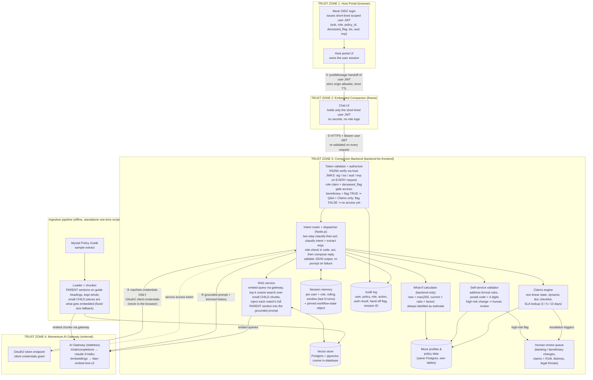
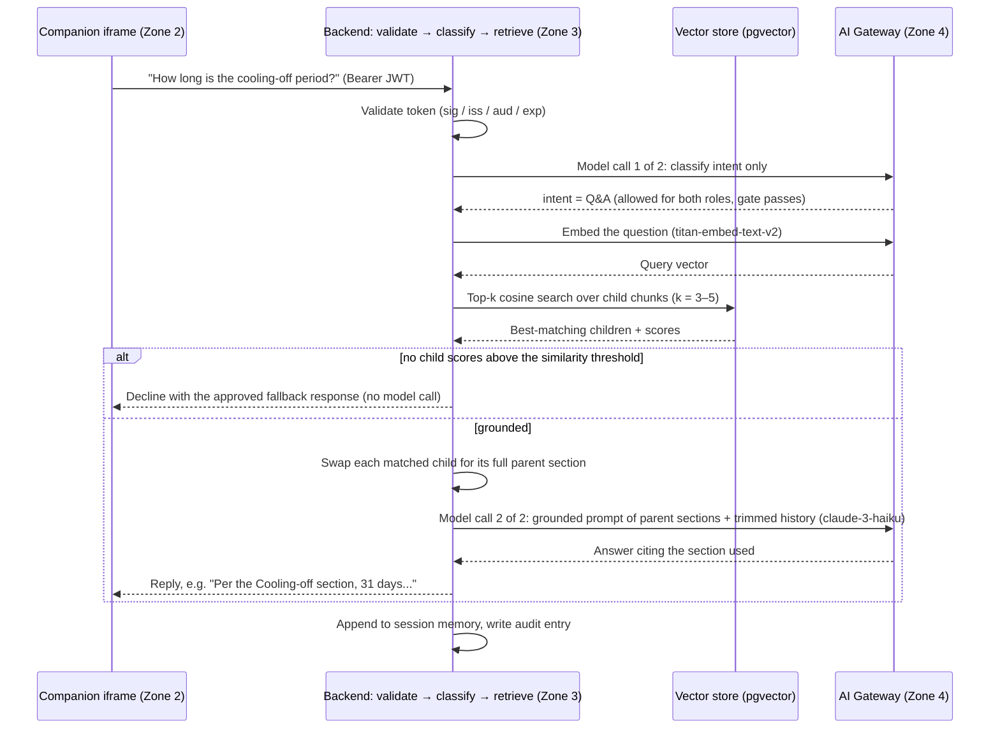

# Architecture: Accessible Life Insurance AI Companion

> v0.3: adds the five journey data flows the brief requires the diagram to map.
> All ten design verdicts are locked in [architecture-decisions.md](architecture-decisions.md).
> The four trust zones, the two separate credential types, the ingestion pipeline, and
> session memory are **mandated** by the brief; the internals of the companion backend are
> our design choices.

## Main architecture diagram



**The two credentials that must never meet:**

| Credential | Lives in | Crosses | Purpose |
|---|---|---|---|
| User JWT (mock OIDC) | Browser (host → iframe) | Host → Companion → Backend only | Who the human is; what their role allows |
| Gateway machine credentials | Companion backend env only | Backend → Gateway only | Identifies our app to Momentum; never in the browser |

## Identity handoff sequence (host → companion → backend)

```mermaid
sequenceDiagram
    participant User
    participant HostPortal as Host portal (Zone 1)
    participant Companion as Companion iframe (Zone 2)
    participant Backend as Companion backend (Zone 3)
    participant Gateway as AI Gateway (Zone 4)

    User->>HostPortal: Log in (mock OIDC)
    HostPortal->>HostPortal: Issue short-lived scoped JWT<br/>(sub, role, policy_id, deceased_flag, iss, aud, exp)
    HostPortal->>Companion: postMessage(JWT), target origin pinned
    Companion->>Companion: Verify event.origin against allowlist
    User->>Companion: "What happens if I lower my cover?"
    Companion->>Backend: POST /chat (Bearer user JWT)
    Backend->>Backend: Validate sig/iss/aud/exp → derive role<br/>(deceased_flag ⇒ Beneficiary)
    Backend->>Gateway: Model call 1 of 2: classify intent only<br/>(OAuth2 client-credentials; the call carries no authority)
    Gateway-->>Backend: intent = whatif (untrusted JSON, validated in code)
    Backend->>Backend: Authorize intent vs role matrix<br/>(Beneficiary + What-If ⇒ refuse with fixed template,<br/>audit entry, and NO second model call)
    Backend->>Backend: If allowed: run What-If formula, assemble grounded prompt
    Backend->>Gateway: Model call 2 of 2: compose reply (/chat/completions)
    Gateway-->>Backend: Model response
    Backend->>Backend: Validate structured output, re-prompt if malformed<br/>Write audit log entry
    Backend-->>Companion: Answer + estimate disclaimer
```

## The five journeys through the architecture

How each core journey travels the main diagram. Every journey shares the same first two
steps: the request arrives with the user JWT, the token validator re-validates it and
derives the effective role, and the intent router classifies the request before any
action runs.

### 1. Authentication and multi-role identity

The sequence diagram above is this journey end to end: the mock login issues the scoped
JWT, the host hands it across the iframe boundary with a pinned target origin, and the
token validator re-checks signature, issuer, audience and expiry on every request. The
deceased flag on the linked policyholder is what unlocks the restricted Beneficiary role:
with the flag set, a beneficiary gets Q&A and claims only; without it, a beneficiary has
no access to the policy yet, and the flag never upgrades anyone to policyholder. The
responsibilities never overlap: Momentum asserts the flag (after death verification), the
host signs it into the token at login, and the companion backend enforces it on every
request, server-side, never in the UI. Every authorization decision, allowed or refused,
is written to the audit log.

### 2. Grounded policy Q&A (RAG)



Contextual honesty is enforced in code: if retrieval finds nothing relevant enough, the
backend declines before the model is ever called, so the assistant cannot invent policy.

### 3. Quotes and alterations (What-If)

The intent router classifies the request as a What-If and the role check runs first: a
Beneficiary is refused here, deterministically, before anything is calculated or
generated (the sequence diagram above shows this refusal path). For a Policyholder, the
What-If calculator runs the backend-only formula
`new = max(200, current × (requested / current_sum) × factor)` against the policy data,
saves the result, and the reply explains the trade-off (for example, a longer waiting
period lowers the premium), always labelled as an estimate, never a final quote, with
human review offered.

### 4. Simple self-service updates (address)

The intent router classifies the request as an update (Beneficiaries are blocked at the
role check). The self-service validator captures the address conversationally, field by
field, into the pinned workflow-state object in session memory, so the user can supply
details in any order and nothing is asked twice. Format validation runs on each field
(required fields present, postal code exactly 4 digits); a province change is logged as
an event. High-risk changes, banking or beneficiary details, never complete in-chat:
they are flagged to the human review queue, and the audit log records the action with
its validation result and hand-off flag.

### 5. Empathetic claims support

The intent router classifies the request as a claim, which both roles may make. The
claims engine is a server-side state machine keyed on claim type: it derives the
document checklist dynamically (every claim needs the claim form, IDs, policy number and
banking details; a death claim adds the death certificate and relationship proof, and so
on) and tracks what is still missing rather than following a fixed script, which is what
makes the flow non-linear: the user can volunteer documents in any order. When the
deceased flag is set, the death certificate is already on file from the insurer's
verification, so the checklist pre-marks it complete and the bereaved is never asked to
supply it. The matching
SLA is communicated up front (death and funeral 3 working days, income protection 5,
disability and critical illness 10). Escalation triggers, a claim over R1M, signs of
distress, legal threats, route to the human review queue with a human always offered.
The model never tracks this state; it only phrases the next step warmly. Every state
transition lands in the audit log.

## Runtime flow in one paragraph

The user logs into the **host portal** (mock OIDC), which issues a short-lived scoped JWT and hands it to the **embedded companion** via `postMessage` with a pinned target origin. Every companion request carries that JWT to the **companion backend**, which re-validates it, derives the effective access (the deceased flag on the linked policyholder unlocks the restricted Beneficiary role), and authorizes the intent against the role-capability matrix before doing anything. The **intent router** supplies what the stateless gateway lacks: it loads and trims session memory, dispatches to backend actions (RAG retrieval, What-If formula, validators, claims engine), assembles a grounded prompt, and calls the **AI Gateway** using OAuth2 machine credentials that exist only in backend config. Model output is validated (JSON re-prompt fallback for the known Python SDK limitation), audit-logged, and high-risk actions are diverted to the human review queue.

## Decisions resolved in this diagram

All locked at the 2026-07-07 session; full options and justifications in
[architecture-decisions.md](architecture-decisions.md):

- [x] Vector store: Postgres + pgvector, cosine in-database
- [x] Session memory: rolling window + pinned workflow-state object
- [x] JWT signing: RS256 with mock JWKS on the host
- [x] Backend runtime: Node.js, two-step classify-then-act, untrusted-JSON validation
- [x] Ingestion: standalone one-time script run offline
- [x] App datastore: same Postgres instance as the vectors, separate tables
