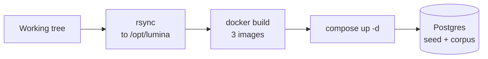
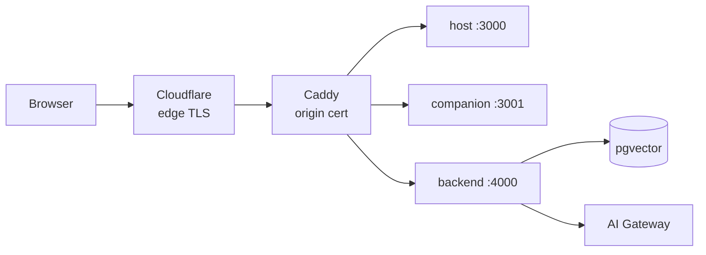

# Deployment flow

From working tree to three public HTTPS origins on one ARM VM. Two halves: ship once, serve every request.

## Ship (once per change)



- **rsync**: the working tree, not a git clone, so uncommitted work ships too. Excludes `node_modules` (wrong architecture: local is x86, the VM is aarch64).
- **Build**: two Next apps and the backend, built on the VM. The public origins are inlined here, not at run time.
- **Up**: Caddy, host, companion, backend, pgvector. Only Caddy is published; Postgres never leaves the internal network.
- **Seed**: `seed.sql` and the RAG schema apply on first boot; the corpus dump loads separately into `rag_chunks`.

## Serve (every request)



- **Three hostnames, three origins**: `lumina`, `companion` and `api-lumina` under one domain.
- Host and companion stay on separate origins deliberately. The `postMessage` allowlisting between them is the trust boundary, and a shared origin would make it decorative.
- **TLS**: Cloudflare at the edge, a wildcard origin certificate on the VM. No ACME step.
- The security list admits 80/443 only from Cloudflare ranges, so the origin cannot be reached directly.
- The gateway key lives only in the backend's environment and never reaches a browser.

## Build-time note

`NEXT_PUBLIC_*` values are baked into the Next bundles during `docker build`. Changing an origin needs a rebuild, not a restart:

```bash
docker compose up -d --build host companion
```

Backend settings (gateway credentials, similarity floor) are read at run time and only need a restart.

## One stack at a time

The VM is shared with an unrelated stack that also wants ports 80 and 443. Starting one means stopping the other; `down` without `-v` leaves all volumes intact.
