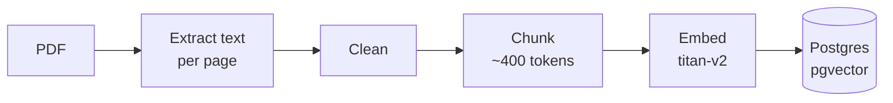
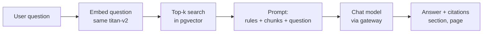

# Myriad guide ingestion flow

From the 454-page PDF to grounded, cited answers. Two halves: ingest once, query every chat turn.

## Ingest (once)

- **Extract**: keep page numbers, they become the citations (printed page = PDF page - 1).
- **Clean**: strip repeated headers/footers so they do not pollute retrieval.
- **Chunk**: split on section headings first, then ~400-token pieces with overlap; tag section + page.
- **Embed**: batch through the gateway with retry/backoff; one-time cost, cents.
- **Store**: pgvector in our existing Postgres, nothing new to run.

## Query (every chat turn)

- Question and corpus must use the same embedding model.
- Prompt rule: answer only from the excerpts, otherwise say "I don't know".
- Model only ever sees the top 5-8 chunks, never the whole guide.

## Tuning note

Chunk size and top-k get frozen after the Sprint 0 spike on one section; every full re-ingestion re-spends embedding budget.
